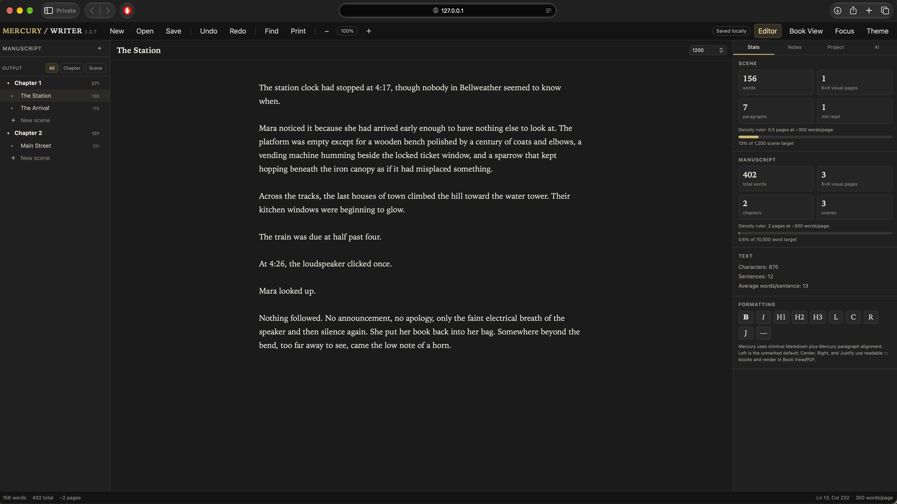

# Mercury Writer 1.6.2 — Your Neovim

A local-first novel writing studio. The browser, your usual Neovim and small
built-in terminal editor edit the same revisioned manuscripts. Mercury works
alone; paired Future Crash + LOOK nodes add offline replication, model routing
and accountless research when available.



## Open a project, online or offline

**Open** shows Mercury Library. Search by project title or author and open a
manuscript without choosing a computer or filesystem. Available offline means
its current copy is verified on this computer. **Import file** is a separate
action for external `.mercury`, Markdown or text files.

`mercury` / `mercury library` opens the terminal catalogue; `mercury open` opens
the same library in the browser. Paired computers replicate project identities,
manuscripts and revision history. Work offline from a local copy; reconnect to
exchange edits. The 3090 is a backup-bearing peer, not a server required for writing.

Readable project copies are under `~/Mercury Writer Documents/NAME/project.mercury`.
The internal library and revisions live in `~/Applications/Mercury-Writer/library`
on macOS and `~/.local/share/mercury-writer/library` on Linux. Use the Library for
normal editing; these paths are for inspection/export/recovery.

The updated Fabric recovery inventory explicitly includes Mercury's library,
revision history and recovery state on the 3090 in its existing encrypted
FabBack repository. A receipt reports manuscript/revision counts only after
restore verification. Sync and backup are separate: edits first reach the 3090,
then the configured backup protects a point in time. Other documents/media are
still outside this targeted scope.

## Browser split view

Run `mercury open`, or `python3 mercury_server.py` and visit
http://127.0.0.1:8765. **Split** (Ctrl/Cmd+Shift+Backslash) opens two stacked
writing panes. Each has its own manuscript navigator, scene selection, caret
and scrolling. Drag the divider, or focus it and use Up/Down, to resize.
Both panes edit shared scene objects, including when viewing one scene twice.

The upper pane owns AI selection, scene notes, formatting and export scope.
**Swap** exchanges scenes when you want those tools on the lower scene.
Book View and Focus return to one pane. Split is also in the mobile menu.
The editor retains chapter/scene organization, notes, targets, Markdown,
Find, themes, recovery, 6 × 9 book preview and PDF/TXT/Markdown/.mercury export.

## Install

Python 3.12+ on macOS or Linux is enough for the browser, server and built-in
editor. No account, model download, package install or build is required.

```sh
./install_mercury.sh --minimal
mercury open
mercury edit --editor mini
```

Add `~/.local/bin` to PATH if needed. The minimal installer verifies runtime
copies, preserves configuration/manuscripts, and supplies `mercury` and
`mercury-server` launchers. The CLI starts its local server on demand.
Custom destinations use `--install-dir PATH --bin-dir PATH` after `--minimal`.
The original interactive installer also offers Ollama and model setup.
Future Crash + LOOK includes an optional companion installation:

```sh
./install.sh --mercury=install
./install.sh --mercury=off
./install.sh --mercury=install --mercury-source=/path/to/MercuryWriter
```

## Compare the terminal desks

```sh
mercury                                      # Library and organization
mercury edit "My Novel"                     # Your configured Neovim, chapter folders
mercury edit "My Novel" --editor nvim --split # Native horizontal split
mercury edit "My Novel" --editor nvim-desk --split
mercury edit "My Novel" --editor mini --split
mercury edit "My Novel" "Arrival" --editor mini
```

The default **Neovim interface** loads your personal configuration and opens
the manuscript directory, with named chapter folders and scene files. Use your
usual directory browser to select chapters/scenes; stock Neovim uses Enter
to open a file/directory and `-` to go up. `:Explore` opens the current file’s
directory. `:split` splits horizontally; `:split path/to/scene.md` opens another
scene, and Ctrl-W then W switches panes. `--split` starts two scene buffers in
a native horizontal split. `:w` saves; `:wq` saves and exits. Written scene files
commit to the same Mercury history about every two seconds. This restores the
original navigation while retaining isolated recovery sessions and safe sync.

The optional **Neovim desk** (`--editor nvim-desk`) bypasses personal config and
retains its full normal/insert/visual behavior. Tab switches manuscript/writing;
Enter opens a scene. `:MercurySplit` or Space-S toggles two writing rows, each
with a navigator. `:w` / Ctrl-S writes a scene; changed files commit through
Mercury about every two seconds. Space-Q writes all buffers and exits.
Ordinary `:qa` refuses unsaved buffers.

The **built-in desk** offers Ctrl-W split, Ctrl-J other pane, Tab navigator,
Enter select, Ctrl-S save and Ctrl-Q exit/commit. `i`, `a`, `o` enter insert;
Esc returns to normal. `hjkl`/arrows move, `v` selects, `y`/`d` copies/deletes
a selection, `x` deletes, `p` pastes, `u`/Ctrl-R undo/redo, and `0`, `$`, `G`
navigate. Commands: `:w`, `:q`, `:wq`, `:split`, `:only`. `?` shows help.
This intentionally bounded editor does not implement all Vim motions, counts,
operators, registers or macros. Neovim remains available for those.

Set `MERCURY_EDITOR=nvim`, `nvim-desk` or `mini` for a default.
Without an override, Mercury uses your normal Neovim when installed, otherwise mini. `--editor external` uses
`$EDITOR` (otherwise vi) for one scene. Every session has a separate recovery
workspace; opening another editor never deletes an existing session's files.

```sh
mercury recover ~/.cache/mercury/workspaces/PROJECT_ID/session-DIRECTORY --editor mini
```

## One identity, offline copies, explicit conflicts

Projects have stable IDs independent of titles, folders, machines or IPs.
Browser, terminal, Library and workspace imports share one per-project revision
lineage. Saves name their expected parent; stale editors cannot overwrite a
newer draft. Mercury preserves their draft as a conflict. Thread/process locks
serialize head changes; immutable snapshots are written before heads advance.

The application directory contains the Library and revision history.
`~/Mercury Writer Documents/TITLE/project.mercury` is a readable offline replica
with an identity/revision receipt. Writing data stays separate from source.
Always Local is the default. Do not choose Fabric Only for work needed offline.

Install Mercury and updated Future Crash + LOOK on each writing computer, pair
the nodes, and enable **Project → Fabric copies** or run:

```sh
mercury sync on
mercury sync now
mercury doctor airplane
```

The resident node exchanges revisions approximately every 15 seconds while
both Mercury servers run. Pairing credentials and certificate-pinned transport
stay inside Fabric; no new unauthenticated remote Mercury service is exposed.
There is no mandatory central server. CLI discovery prefers this computer,
never a server chosen by project count. An explicit `MERCURY_URL` selects that
server without silently falling back elsewhere.

Only ancestry permits automatic updates. Divergent offline edits remain visible
conflicts; wall clocks never select a winning manuscript.

```sh
mercury conflicts
mercury resolve "My Novel" CONFLICT_REVISION_ID
```

Resolve explicitly chooses that draft and creates a new revision acknowledging
both branches. Both originals remain in history. Inspect conflict JSON and
merge text manually first if both drafts contain work you need.

Deletion affects this Library only and stays deleted through subsequent sync;
Recently Deleted restores it. A factory reset makes its safety archive and
turns sync off to prevent immediate repopulation. Keep independent backups:
replication can also distribute mistaken edits.

Exchange batches are bounded to 6 MiB; oversized individual revisions report an
error and need manual export. Folder organization and availability preferences
stay local. Browser-only endpoints need a local Mercury server for durable
offline replicas. Browser storage is a crash buffer, not that durable replica.

## AI and research

Mercury keeps its own writing prompts, context and project memory. When LOOK's
installed Fabric client is available, it lists trusted nodes' models and uses
the client for authenticated inference. Local/configured Ollama is the fallback.
User config precedes bundled defaults: `~/.config/mercury/ai.json`, or explicit
`MERCURY_AI_CONFIG`. Web research tries Fabric SearXNG before optional Ollama
search with an existing `OLLAMA_API_KEY`. Fabric search needs no account/key.
Manuscript sync does not merge Mercury memory into LO memory.

## LOOK Note links

Use **Project → Copy project link for LOOK Notes**, or `mercury link "My Novel"`.
Paste `[My Novel](mercury:PROJECT_ID)` beside research and file references.
Updated LOOK resolves the stable ID through the local library and opens the
browser project. Rename/move the manuscript without breaking its link. A missing
local replica produces a next step; opening a link never creates a replacement.

## Verification

```sh
python3 -m unittest discover -s tests -v
node tests/browser_saves.cjs
```

Tests use disposable storage and cover concurrent saves, offline ancestry,
conflicts/resolution, deletion/reset, terminal recovery, installer preservation,
both terminal desks, and browser save/poll races. Neovim's test skips if absent.
